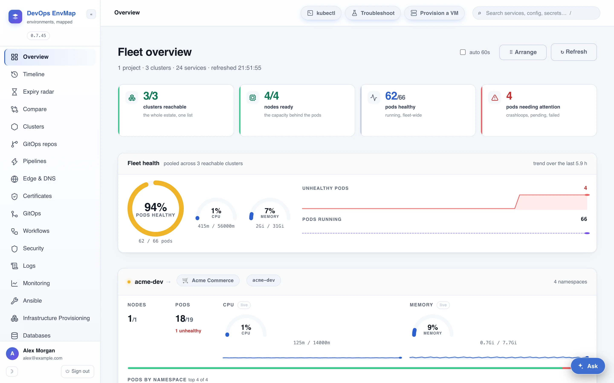
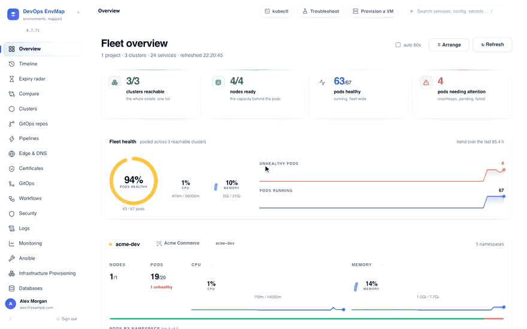
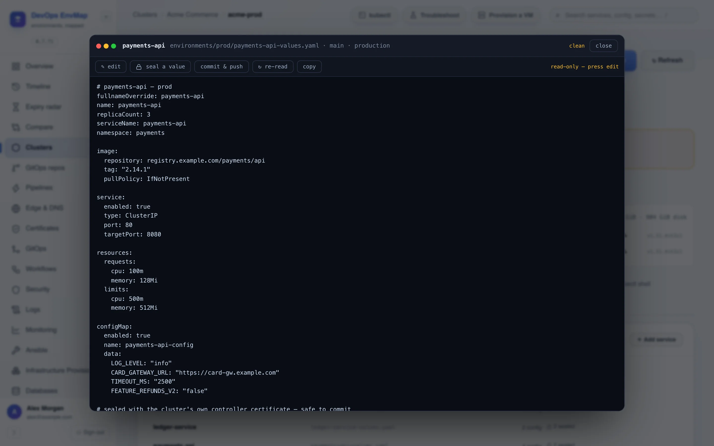
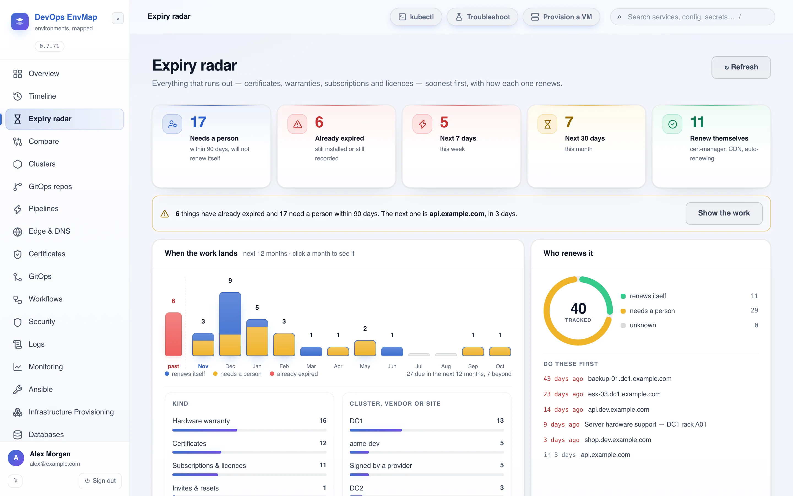
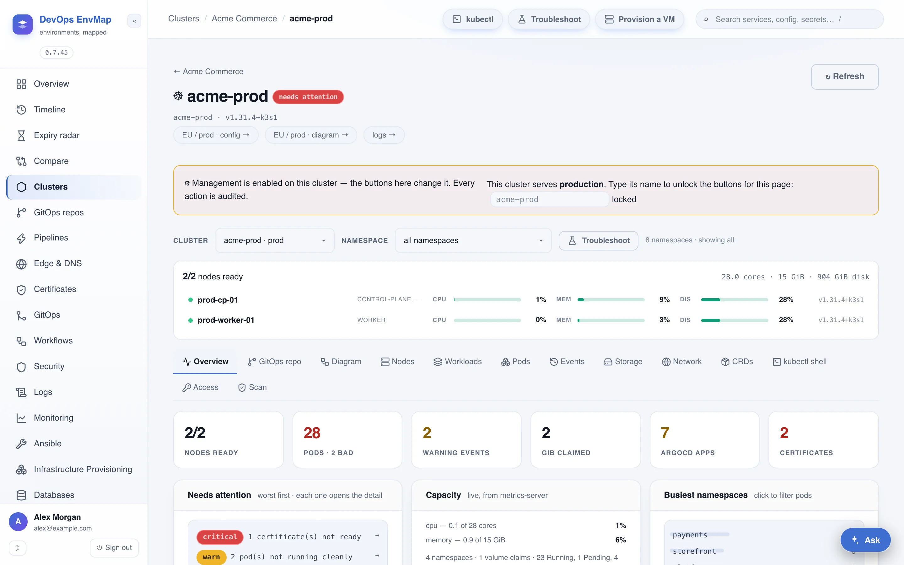
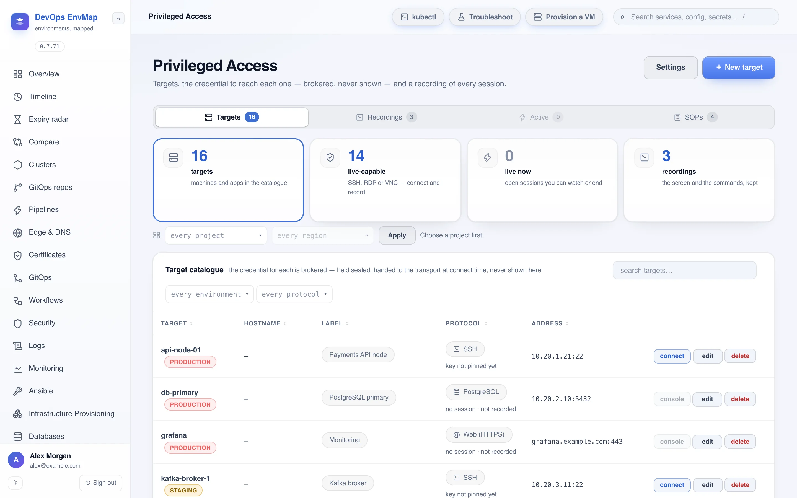

# DevOps EnvMap

**Your whole DevOps estate on one screen, with a privileged access manager that records every session.** Self-hosted and open source.

[](https://github.com/ammar-hassoun/envmap/releases)
[](LICENSE)
[](https://envmap.tech/docs/)

[Website](https://envmap.tech) · [Docs](https://envmap.tech/docs/) · [See the demo](https://envmap.tech/demo/) · [Walk the 3D city](https://envmap.tech/play/) · [Discussions](https://github.com/ammar-hassoun/envmap/discussions)



EnvMap reads the systems you already run and shows them together: Kubernetes clusters, the GitOps values behind them, Argo CD and Flux, pipelines, monitoring, logs, certificates, clouds, hypervisors and server hardware. It also lets a team act on what it sees, through git and through recorded sessions.

It runs in your own cluster or on one machine with Docker. There is no licence key, no account to register and no telemetry.

## Try it

**Look first, install nothing.** [The demo](https://envmap.tech/demo/) is the real screens with pretend data. [The 3D city](https://envmap.tech/play/) is a pretend estate you can walk through and repair.

**Docker Compose**, on any machine with Docker:

```bash
curl -fsSLO https://raw.githubusercontent.com/ammar-hassoun/envmap/main/deploy/compose/compose.yaml
docker compose up -d
```

**Kubernetes**, with Helm:

```bash
helm install envmap oci://ghcr.io/ammar-hassoun/devops-portal-charts/config-portal \
  --namespace envmap --create-namespace
kubectl -n envmap port-forward svc/envmap-config-portal 8471:8471
```

Then open <http://localhost:8471>, create the first administrator and enrol an authenticator app. There is no default account and no default password. [Install](https://envmap.tech/docs/getting-started/install/) covers TLS, upgrades and the values worth knowing.

**Only need the privileged access manager?** Start it as that and nothing else:

```bash
ENVMAP_MODE=pam docker compose up -d        # Docker Compose
helm install envmap oci://ghcr.io/ammar-hassoun/devops-portal-charts/config-portal \
  --namespace envmap --create-namespace --set portal.mode=pam        # Helm
```

## What it does

### Privileged access, recorded

Open SSH, RDP and VNC sessions from the browser. The password or key stays sealed inside EnvMap and is never shown to the person connecting. Every session is recorded from its first second.



- Replay any session at any speed, and read an SSH session as the commands that were typed.
- Watch a live session, take the keyboard, or end it.
- Production targets can ask for the host's name, a ticket and a reason before a session opens.
- Runbooks open beside the shell. A step is pasted, never run, until you press Enter.

[How Privileged Access works](https://envmap.tech/docs/pam/overview/)

### The rest of the day job, in the same place

| | |
|---|---|
|  |  |
| **GitOps values, changed through git.** Edit a values file, seal a secret with the cluster's own certificate, then commit and push with your name on it. | **Expiry radar.** Certificates, hardware warranties, subscriptions and licences on one clock, soonest first. |
|  |  |
| **Kubernetes, read live.** Every cluster, node, workload, pod and event, with logs and a kubectl shell. Changes are off until you switch them on for one cluster. | **One catalogue of what can be reached.** Targets by environment, each with its sealed credential and its recordings. |

Also in the box:

- **Argo CD and Flux**: sync state, health, history and diffs across controllers.
- **Pipelines and workflows**: Jenkins, GitHub Actions, GitLab CI, Bitbucket Pipelines, Temporal and Airflow.
- **Monitoring and logs**: firing alerts, Grafana dashboards drawn in place, Elasticsearch, OpenSearch and Loki.
- **Certificates**: request, renew and download, with the private key kept sealed.
- **Infrastructure**: Proxmox, vCenter and ESXi, server hardware over Redfish, cloud accounts, storage and IT spend. A preview moves a VM between Proxmox and ESXi hosts: a running Linux VM without stopping it, a powered-off VM without starting it.
- **Ansible and Terraform**: playbooks, check runs, schedules, stacks and new virtual machines.
- **AI clients over MCP**: connect Claude Code, Cursor or VS Code with a token that carries only its owner's permissions.
- **Roles, MFA and audit**: roles built from permission areas, an authenticator for everyone, and a hash-chained log of every change.

[The docs](https://envmap.tech/docs/) have one page for every screen.

## How it behaves

- **Read-only first.** Every connection and every cluster starts read-only. Writing is switched on for one cluster at a time and granted to named people.
- **Git is the write path for configuration.** A change to a values file is a commit by the signed-in person. Argo CD, Flux or your pipeline deploys it as it does today.
- **Nothing about your estate is in the code.** Projects, clusters, repositories and credentials are entered in the running portal and kept in its own database.
- **"None" and "could not ask" never look the same.** A system that did not answer shows a dash or an error, never a zero.
- **It does not replace what you run.** It reads Argo CD, Grafana, Jenkins and the rest, and links back to them.

## What it does not do yet

- **One node.** State is a SQLite database on one volume. More replicas add capacity on the same node, not survival of a node failure.
- **Single sign-on is Microsoft Entra ID only.** Generic OIDC and SAML are not supported yet.
- **Privileged Access** has no access requests with approval, no command filtering and no automatic credential rotation yet. Recorded web sessions need a Kubernetes cluster.
- **Several integrations only read**: pipelines, workflow engines, scanners, log platforms, storage devices, VPN portals and Flux.

The full list is in [the reference](docs/REFERENCE.md#known-limitations).

## Security

EnvMap holds kubeconfigs, git tokens and session credentials, so check it before you trust it.

- Stored credentials are sealed in the database. Put the portal behind TLS before anybody signs in.
- The chart and the Compose file run the image as a non-root user on a read-only filesystem, with every capability dropped.
- Every release image is signed. Verify the one you run:

```bash
cosign verify ghcr.io/ammar-hassoun/devops-portal:latest \
  --certificate-oidc-issuer https://token.actions.githubusercontent.com \
  --certificate-identity https://github.com/ammar-hassoun/devops-envmap/.github/workflows/release.yml@refs/heads/main
```

Read [the security model](https://envmap.tech/docs/reference/security-model/). To report a vulnerability, see [SECURITY.md](SECURITY.md).

## Learn more

- [Docs](https://envmap.tech/docs/): install, first run, and a page for every screen
- [Reference](docs/REFERENCE.md): every feature, the data model, configuration and development
- [Roadmap](ROADMAP.md): what is planned next
- [Contributing](CONTRIBUTING.md): how to report a problem or send a change
- [Discussions](https://github.com/ammar-hassoun/envmap/discussions): questions and ideas

## Licence

Apache License 2.0. See [LICENSE](LICENSE).
